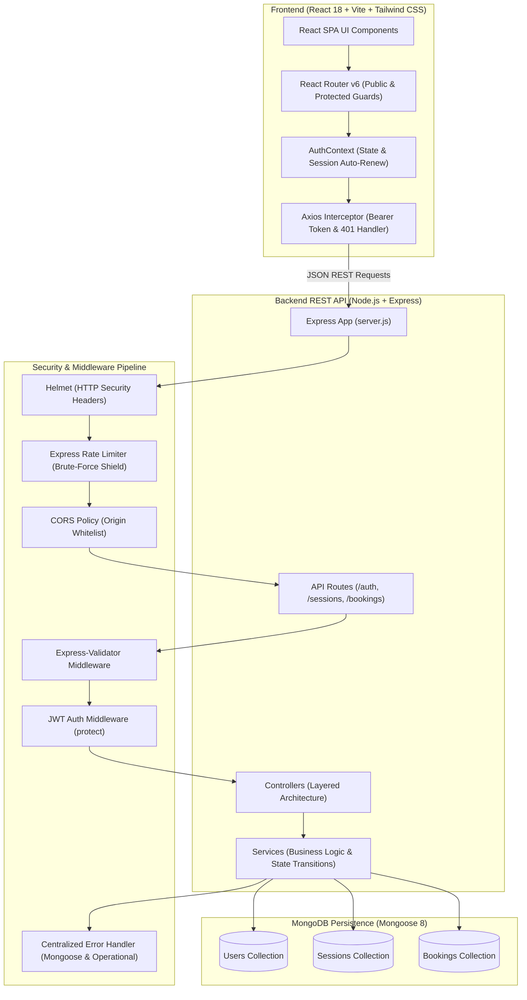
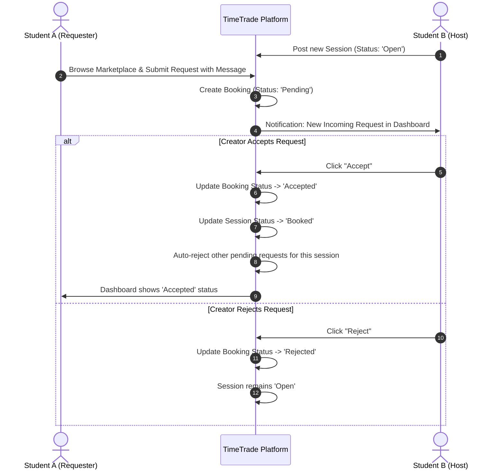

# TimeTrade: Student Time-Exchange Board

[](https://reactjs.org/)
[](https://vitejs.dev/)
[](https://tailwindcss.com/)
[](https://nodejs.org/)
[](https://expressjs.com/)
[](https://www.mongodb.com/)
[](LICENSE)

> **BCA Semester 5 Capstone Project** • Frontend Application Development Using REACT & Node.js REST Backend.  
> A production-grade, two-sided peer time-banking platform where university students exchange academic help, handwritten notes, coding mentorship, and presentation reviews through reciprocal time credits.

---

## Table of Contents
1. [Problem Statement & Project Vision](#problem-statement--project-vision)
2. [Key Features](#key-features)
3. [System Architecture](#system-architecture)
4. [Two-Sided Request Workflow (State Machine)](#two-sided-request-workflow-state-machine)
5. [Database Data Models](#database-data-models)
6. [REST API Specification](#rest-api-specification)
7. [Directory Structure](#directory-structure)
8. [Local Environment Setup](#local-environment-setup)
9. [Pre-Seeded Demo Test Accounts](#pre-seeded-demo-test-accounts)
10. [Git & GitHub Publishing Guide](#git--github-publishing-guide)
11. [Production Deployment Guide](#production-deployment-guide)

---

## Problem Statement & Project Vision

Students frequently require short, high-yield academic assistance:
* Troubleshooting elusive code bugs or environment setup issues.
* Reviewing handwritten lecture notes and exam revision questions.
* Practicing capstone presentation slide delivery and defense.
* Solving discrete mathematics or algorithmic proofs.

Traditional tutoring services are expensive and impersonal. **TimeTrade** implements a reciprocal **Time-Exchange Board**: students offer sessions in areas where they excel and request slots on peer sessions in subjects where they need support—fostering collaborative campus peer learning without financial barriers.

---

## Key Features

### 1. Robust Student Authentication & Identity
* Secure JWT token issuance with `bcryptjs` password hashing (10 salt rounds).
* Protected client routes (`ProtectedRoute.jsx`) and guest redirection guards (`PublicRoute.jsx`).
* Centralized Axios interceptors automatically injecting bearer tokens and gracefully handling 401 token expirations.
* User profile editing (Name, Department, Avatar URL, and Academic Bio).

### 2. Live Session Marketplace
* Real-time search across session titles, skill keywords, and descriptions.
* Category filter tabs: `Notes`, `Coding`, `Presentation Practice`, `Academic Support`, `Other`.
* Status filtering: Available (`Open`), `Booked`, or `All`.
* Detailed session views displaying host department, session duration, and prerequisites.

### 3. Full CRUD Session Offerings
* Authenticated students can publish new time-exchange sessions.
* Instant editing and deletion capabilities for session hosts.
* One-click "Mark as Completed" status transitions.

### 4. Two-Sided Slot Request System
* Requester submits a booking with an introductory note and learning goals.
* Creator reviews incoming pending requests with requester profiles.
* **Mutual Confirmation**: When a host clicks **Accept**, the booking is marked `Accepted`, the session status automatically switches to `Booked`, and all conflicting pending requests are safely rejected.
* Either party can cancel a request, restoring the session to `Open` status if it was previously booked.

### 5. Multi-Tab Student Dashboard
* **My Active Sessions**: Manage all created offerings, edit schedules, or remove listings.
* **Incoming Requests**: Accept or reject pending incoming requests with live badge alerts.
* **My Sent Requests**: Track request status (`Pending`, `Accepted`, `Rejected`) and cancel requests if schedules change.
* **Completed History**: Comprehensive log of time exchanged and peer meetings completed.

---

## System Architecture



---

## Two-Sided Request Workflow (State Machine)



---

## Database Data Models

### 1. User (`User.js`)
| Field | Type | Description |
|---|---|---|
| `name` | String | Student's full name (required, max: 60) |
| `email` | String | Unique university email (indexed, normalized) |
| `password` | String | Hashed password via bcrypt (hidden in queries by default) |
| `department` | String | Academic major (e.g. Computer Science, Data Science) |
| `avatarUrl` | String | Profile image URL (falls back to Dicebear avatar) |
| `bio` | String | Short self-introduction and skills overview |
| `timestamps` | Date | `createdAt` and `updatedAt` |

### 2. Session (`Session.js`)
| Field | Type | Description |
|---|---|---|
| `creator` | ObjectId (ref: User) | User who offered the session (indexed) |
| `title` | String | Offering title (required, max: 120) |
| `category` | Enum | `['Notes', 'Coding', 'Presentation Practice', 'Academic Support', 'Other']` |
| `description` | String | Detailed session scope and notes provided |
| `skillOffered` | String | Specific tags (e.g., React, Git, Discrete Math) |
| `durationMinutes` | Number | Session duration in minutes (10–240, default: 45) |
| `timeSlot` | String | Scheduled time or preferred availability |
| `status` | Enum | `['Open', 'Booked', 'Completed', 'Cancelled']` (default: 'Open') |
| `timestamps` | Date | `createdAt` and `updatedAt` |

### 3. Booking (`Booking.js`)
| Field | Type | Description |
|---|---|---|
| `session` | ObjectId (ref: Session) | Target session being requested (indexed) |
| `requester` | ObjectId (ref: User) | Student requesting the slot (indexed) |
| `creator` | ObjectId (ref: User) | Host of the session |
| `message` | String | Personal note or learning goals (max: 500) |
| `status` | Enum | `['Pending', 'Accepted', 'Rejected', 'Cancelled']` (default: 'Pending') |
| `timestamps` | Date | `createdAt` and `updatedAt` |

---

## REST API Specification

### Authentication (`/api/auth`)
| Method | Endpoint | Access | Description |
|---|---|---|---|
| `POST` | `/api/auth/register` | Public | Register a new student account |
| `POST` | `/api/auth/login` | Public | Login with email and password (returns JWT) |
| `GET` | `/api/auth/me` | Private | Retrieve authenticated student profile |
| `PUT` | `/api/auth/profile` | Private | Update student profile information |

### Sessions (`/api/sessions`)
| Method | Endpoint | Access | Description |
|---|---|---|---|
| `GET` | `/api/sessions` | Public | Search and browse sessions with filters & pagination |
| `GET` | `/api/sessions/my` | Private | Retrieve all sessions created by logged-in student |
| `GET` | `/api/sessions/:id` | Public | Get single session details and host profile |
| `POST` | `/api/sessions` | Private | Offer a new session |
| `PUT` | `/api/sessions/:id` | Private | Update session details (host only) |
| `DELETE` | `/api/sessions/:id` | Private | Remove session offering and purge requests (host only) |

### Bookings & Requests (`/api/bookings`)
| Method | Endpoint | Access | Description |
|---|---|---|---|
| `POST` | `/api/bookings` | Private | Submit slot request with note |
| `GET` | `/api/bookings/incoming` | Private | Get incoming requests for host's sessions |
| `GET` | `/api/bookings/my` | Private | Get requests sent by logged-in student |
| `PATCH`| `/api/bookings/:id/status` | Private | Accept or Reject incoming request (host only) |
| `PATCH`| `/api/bookings/:id/cancel` | Private | Cancel a request (requester or host) |

### Health Check
| Method | Endpoint | Access | Description |
|---|---|---|---|
| `GET` | `/api/health` | Public | Service uptime and MongoDB connection state |

---

## Directory Structure

```
timetrade-platform/
├── client/                              # React 18 + Vite Frontend
│   ├── src/
│   │   ├── api/                         # Axios client & typed REST wrappers
│   │   │   ├── axios.js                 # JWT bearer injection & 401 handling
│   │   │   ├── authApi.js
│   │   │   ├── sessionApi.js
│   │   │   └── bookingApi.js
│   │   ├── components/
│   │   │   ├── common/                  # Navbar, Footer, Badges, Modal, Spinner
│   │   │   ├── dashboard/               # 4-Tab student dashboard panels
│   │   │   └── sessions/                # SessionCard, SessionFilter, RequestModal
│   │   ├── context/
│   │   │   └── AuthContext.jsx          # Global auth state & session verification
│   │   ├── pages/                       # Landing, Marketplace, Create, Edit, Auth
│   │   ├── App.jsx                      # React Router v6 route configuration
│   │   ├── index.css                    # Tailwind CSS configuration
│   │   └── main.jsx                     # Vite root entry
│   ├── .env.example                     # Client environment template
│   ├── .gitignore                       # Client-specific Git exclusions
│   ├── package.json                     # Client dependencies
│   ├── tailwind.config.js               # Tailwind design system tokens
│   └── vite.config.js                   # Vite configuration
│
├── server/                              # Node.js + Express REST API
│   ├── config/
│   │   └── db.js                        # Mongoose connection & lifecycle hooks
│   ├── controllers/                     # Request controllers
│   ├── middleware/                      # Auth, Error handling, Rate limiting, Validation
│   ├── models/                          # User, Session, and Booking Mongoose schemas
│   ├── routes/                          # Express REST API routes
│   ├── services/                        # Business logic & two-sided state machine
│   ├── utils/                           # Standardized logger & JSON API response helpers
│   ├── seed.js                          # Realistic demo data seeder
│   ├── server.js                        # Main Express server entry point
│   ├── .env.example                     # Server environment template
│   ├── .gitignore                       # Server-specific Git exclusions
│   └── package.json                     # Server dependencies
│
├── .gitignore                           # Root Git hygiene exclusions
├── LICENSE                              # MIT License
├── package.json                         # Root orchestration scripts
└── README.md                            # Comprehensive documentation
```

---

## Local Environment Setup

### Prerequisites
* **Node.js**: v18.0.0 or higher (v20+ recommended)
* **npm**: v9.0.0 or higher
* **MongoDB**: A running local MongoDB instance (`mongodb://127.0.0.1:27017/timetrade`) or a free [MongoDB Atlas](https://www.mongodb.com/atlas) cluster URI.

### 1. Clone & Install Dependencies
From the repository root:
```bash
# Install root dependencies
npm install

# Install client and server packages
npm run install:all
```

### 2. Configure Environment Variables

**Backend (`server/.env`):**
```bash
cp server/.env.example server/.env
```
Ensure the variables in `server/.env` are populated:
```env
PORT=5000
NODE_ENV=development
MONGO_URI=mongodb://127.0.0.1:27017/timetrade
JWT_SECRET=your_development_secret_key_change_in_production
JWT_EXPIRES_IN=7d
CLIENT_URL=http://localhost:5173
```

**Frontend (`client/.env`):**
```bash
cp client/.env.example client/.env
```
Ensure the client points to the backend:
```env
VITE_API_BASE_URL=http://localhost:5000/api
```

### 3. Seed the Database with Realistic Demo Data
Populate 5 sample student profiles and diverse session offerings:
```bash
cd server
npm run seed
```

### 4. Start the Application
You can run both client and server concurrently with one command from the project root:
```bash
# Run both frontend and backend concurrently
npm run dev
```

Or run them individually in separate terminal windows:
```bash
# In terminal 1 (Backend):
cd server
npm run dev

# In terminal 2 (Frontend):
cd client
npm run dev
```

* Frontend application: [http://localhost:5173](http://localhost:5173)
* Backend REST API: [http://localhost:5000](http://localhost:5000)
* Health Check: [http://localhost:5000/api/health](http://localhost:5000/api/health)

---

## Pre-Seeded Demo Test Accounts

The seed script (`server/seed.js`) provides 5 student accounts with pre-populated sessions and requests.  
**Default Password for all demo accounts:** `password123`

| Name | Email | Department | Sample Role |
|---|---|---|---|
| **Alex Chen** | `alex.chen@university.edu` | Computer Science | Host of "React 18 Hooks & State Architecture" |
| **Sarah Jenkins** | `sarah.jenkins@university.edu` | Data Science | Host of "Semester 5 Notes Review" |
| **Marcus Taylor** | `marcus.taylor@university.edu` | Software Engineering | Host of "Mock Capstone Defense & Slide Polish" |
| **Priya Patel** | `priya.patel@university.edu` | Information Technology | Host of "Tailwind CSS Layout Mastery" |
| **David Kim** | `david.kim@university.edu` | Mathematics & Computing | Host of "Discrete Math Graph Theory" |

> **Pro Tip**: On the `/login` page, click any of the **1-Click Quick Fill** student pill buttons to test the two-sided exchange immediately without typing.

---

## Git & GitHub Publishing Guide

To push this project to a new public or private GitHub repository:

```bash
# 1. Initialize Git in the project root
git init

# 2. Stage all files (strictly respecting .gitignore)
git add .

# 3. Create initial commit
git commit -m "feat: complete production-grade TimeTrade platform"

# 4. Set default branch to main
git branch -M main

# 5. Link to your GitHub repository
git remote add origin https://github.com/<your-username>/timetrade-platform.git

# 6. Push to GitHub
git push -u origin main
```

---

## Production Deployment Guide

### Backend Deployment (e.g. Render, Railway, Fly.io)
1. Push repository to GitHub.
2. Create a new **Web Service** on [Render](https://render.com) pointing to the `/server` root directory.
3. **Build Command**: `npm install`
4. **Start Command**: `node server.js`
5. Configure Environment Variables in Render:
   - `NODE_ENV=production`
   - `PORT=10000`
   - `MONGO_URI=<your-mongodb-atlas-connection-string>`
   - `JWT_SECRET=<strong-random-32-byte-hex-string>`
   - `JWT_EXPIRES_IN=7d`
   - `CLIENT_URL=https://your-client-domain.vercel.app`

### Frontend Deployment (e.g. Vercel, Netlify)
1. Create a new project on [Vercel](https://vercel.com) and import the repository.
2. Set **Root Directory** to `client`.
3. Set **Framework Preset** to `Vite`.
4. Configure Environment Variables:
   - `VITE_API_BASE_URL=https://your-backend-service.onrender.com/api`
5. Click **Deploy**.

---

## License
Distributed under the **MIT License**. See [`LICENSE`](LICENSE) for details.
